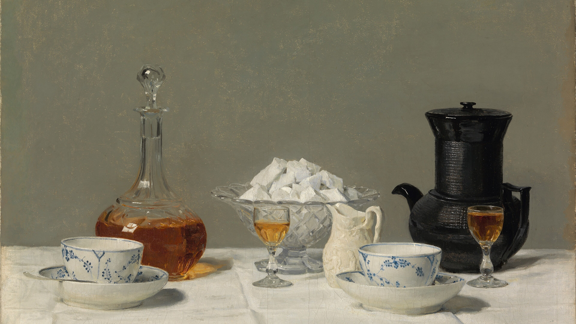

# oma-caffe

> ⚡ *Powered by caffeine and questionable life choices.*

A specialty coffee suite for [Omarchy](https://omarchy.org): two hand-tuned
themes, a bar module that counts cups and tracks active caffeine, a recipe lab
with a guided brew timer, a shot dial-in log and full-screen Coffee Time breaks.



## Install

From the [Omarchy plugin marketplace](https://omarchyplugins.com), or directly:

```bash
omarchy plugin add https://github.com/RohiRIK/oma-caffe.git --enable
```

That puts the cup on your bar and gives you the café panel and the Studio
window right away. For the extras (the three themes, `oma-caffe` on your
`PATH`, the minute timer that fires breaks and Auto-Roast, and the overlay
blur), run the installer from the plugin folder:

```bash
~/.config/omarchy/plugins/rohirik.oma-caffe/install.sh
```

Or clone it anywhere and let the installer link everything:

```bash
git clone https://github.com/RohiRIK/oma-caffe.git ~/Work/oma-caffe
~/Work/oma-caffe/install.sh
```

Everything is symlinked from the checkout, so `git pull` (or `omarchy plugin update`) updates the install.
`install.sh` will:

- link `oma-caffe` into `~/.local/bin`
- link the shell plugin to `~/.config/omarchy/plugins/rohirik.oma-caffe` (unless it already lives there) and put it on the bar
- link the `crema-light`, `ristretto-dark` and `strawberry-latte` themes into `~/.config/omarchy/themes`
- seed `~/.local/share/oma-caffe/` (`recipes.json`, `beans.json`, `state.json`)
- add `require("hypr.oma-caffe")` to `~/.config/hypr/hyprland.lua` to blur the break overlay. It backs up the file first, checks `hyprctl configerrors` and rolls back if there are errors
- enable `oma-caffe-tick.timer` (systemd user timer, once a minute) for breaks and Auto-Roast
- restart the Omarchy shell. A symlinked plugin needs a restart: a rescan doesn't pick it up

Skip any part with `--no-hypr`, `--no-timer`, `--no-bar` or `--no-restart`.
Nothing outside those paths is touched, and an existing file that isn't a
symlink is left alone.

### Remove

```bash
~/.config/omarchy/plugins/rohirik.oma-caffe/uninstall.sh   # only if you ran install.sh
omarchy plugin remove rohirik.oma-caffe
```

`uninstall.sh` removes the links, the timer and the Hyprland `require` line.
Your cups, recipes and settings in `~/.local/share/oma-caffe` and
`~/.config/oma-caffe` stay unless you pass `--purge`. Wallpapers you added from
the gallery live in `~/.config/omarchy/backgrounds/<theme>/oma-caffe-*.jpg`.

### Dependencies

Python 3.9+ (stdlib only), `curl`, `jq`, `notify-send`, `mpv` (ambience),
`gum` (terminal flows) and ImageMagick `magick` (wallpaper gallery). Omarchy
ships all of them. Gallery images download from Wikimedia Commons on demand.

## The bar module

`󰛊 3 · 142mg`: cups today and active caffeine (5 h half-life). The cup fills
when you log one and steams while Caffeine Lock is on. The count turns to the
alert colour past the daily guide (400 mg).

| Input | Action |
|---|---|
| Left click | Open the **café panel** (below) |
| Middle click | Log +1 of your current drink (scroll to change which). The cup fills, then steams, with a pun on the OSD. |
| Right click | Caffeine Lock. Drives Omarchy's own stay-awake, so the idle service, the indicator and *Stay Awake* in the menu all agree. |
| Scroll | Cycle the scroll drinks: Espresso → Turbo Shot → Chemex/Pour-Over → AeroPress → Cold Brew |
| Hover | Mood, cups, active mg and when you're under 50 mg, drink, bean/grinder, top recipe, lock, next break |

### The café panel

- **Mood and level:** a kawaii face that reacts to your caffeine, from `(－_－) zzZ` to `ヽ(°〇°)ﾉ`. Barista levels run from *Decaf Dabbler* to *Legend of the Crema*, with an XP bar and a fresh coffee pun.
- **Caffeine gauge:** active mg against the daily guide, and when you'll be sleep-safe.
- **Quick actions:** +1 cup, Caffeine Lock, Ambience, Theme cycle, Focus 25 (pomodoro), Break now, Dial-in.
- **Drink menu:** 22 drinks across espresso, milk drinks, filter, immersion, tea and cans. Click one to log it; right-click to make it your default. Add your own with `oma-caffe drinks add "Oat Cortado" --mg 130 --method "Milk Drink" --icon 🌾`.
- **Today:** every cup, each with a ✕ to remove it. Undo in the header, or `oma-caffe undo 3`.
- **This week:** a 7-day bar chart, streak, average per day, favourite drink, and how many drinks and methods you've tried.
- **Achievements:** 14 badges (First Sip, Triple Threat, Night Owl, Bean Explorer, Volcanic 7-day streak, Decaf Hero…). Each one pops a notification when it unlocks.
- **Recipe of the day** and your favourites. Click one to start the guided brew timer.

Keys inside the panel: `c` cup · `u` undo · `l` lock · `a` ambience · `t` theme · `f` focus · `b` break · `d` dial · `r` lab.
Bind it to a key with `omarchy-shell rohirik.oma-caffe toggle`.

From the terminal: `oma-caffe stats`, `oma-caffe badges`, `oma-caffe cups`, `oma-caffe cups rm <id>`, `oma-caffe drinks`.

The widget only renders JSON from `oma-caffe status --json`. It runs every
command in an async `Process`, so nothing can block the bar. CLI changes call
`omarchy-shell rohirik.oma-caffe refresh` so every monitor updates at once.

## Themes: Crema Light, Ristretto Dark & Strawberry Latte

**Strawberry Latte** is the soft one: strawberry-milk pastels, caramel and
cocoa ink. Each theme ships five calm, high-resolution wallpapers: classic
café paintings (Van Gogh, Anker, Juan Gris) alongside minimal and cozy coffee
photography. **Studio → 🖼 Wallpapers** is a gallery of 25 curated photos and
paintings, filterable by Art / Minimal / Cozy / Latte / Dark / Light. Click to
set one now, or add it to any theme's rotation (downloaded full-size into
`~/.config/omarchy/backgrounds/<theme>/`, cropped to 16:9, never upscaled).
All public domain or CC0 (one CC BY-SA), credited in `themes/CREDITS.md`.
CLI: `oma-caffe wallpapers`, `oma-caffe wallpapers set night-cafe`.
`oma-caffe theme cute`, or `oma-caffe theme cycle` to rotate through all three.


These are full Omarchy themes (`colors.toml` + wallpaper + icons). One
`omarchy theme set` retints the terminal, bar, menus/launcher, gum TUIs,
Hyprland borders and every templated app. Every text colour meets WCAG AA
(4.5:1) on the background, the card surface and the selection. Borders meet
3:1. `test/test_contrast.py` enforces this.

```bash
oma-caffe theme light | dark | toggle
oma-caffe theme auto on          # Auto-Roast: light 07:00, dark 18:30
oma-caffe config theme.dark_at 19:15
```

Auto-Roast only switches between the two caffe themes. If you pick another
theme by hand, it leaves it alone.

## oma-caffe Studio

A real window, not a terminal. Open it from the café panel (the 󰙨 and 󰒓
buttons, or click any recipe), with `oma-caffe studio [page]`, or from the
break overlay's **R**. It floats and centres itself using Hyprland's runtime
dispatchers, so no `hyprland.lua` edit is needed.

| Page | What you can do |
|---|---|
| 📖 Recipes | Search and filter (Faves / Testing / To Try). Drag the **dose slider** and the output and every pour rescale live. Brew, rate with clickable stars and notes, branch an experiment (grind / temp / dose / name), set status, set active, delete. Tasting history. |
| ⏱ Brew | A big progress ring with step ticks, NOW (with the target weight, large), NEXT with a countdown, and the step list. Each step fires a chime, an OSD and a notification. Space / n / r. At the end: log the cup and rate it. Cold brew schedules a reminder per step. |
| 🔍 Discover | Search the curated library and your feeds, add recipes with one click, import from a URL or pasted text with a preview, manage community feeds. |
| 🎯 Dial-in | Recipe picker, grind field, sliders for dose / yield / time with live ratio and g/s, puck-prep and taste chips. Logging a shot gives advice for the next one. Recent shots on the right. |
| 🫘 Beans | Your shelf: switch bags, save the grind, add a bag, name your grinder and burrs. |
| 🖼 Wallpapers | The curated gallery: filter, preview, set now, add to or remove from each theme's rotation. |
| 📊 Stats | Level and XP, 8 stat tiles, a 7-day chart, every achievement with its description. |
| ⚙️ Settings | **My gear**: type your grinder and espresso machine (fuzzy autocomplete over ~20 of each). You get the grinder's scale with every brew method mapped on it, a calibration to your own sweet spot, and the machine's portafilter, basket, temperature, pressure and pre-infusion with tips. Every recipe then shows "start at N clicks" and machine advice, and dial-in names the exact next setting. Fit **upgrades** like flow control/pressure profiling, PID retrofit, OPV 9 bar, Gaggiuino, dimmer, E61 group thermometer, gauge, precision basket (with your size), puck screen and more. Only the ones that fit your machine are offered, and they change the advice (e.g. "cap 6 bar with the flow-control paddle", "flush until the group reads 93°C"). Not in the list? Describe your machine by hand. **Bar** toggles hide the cup count and/or the mg. Also: half-life, daily guide, cutoff; themes and Auto-Roast; ambience volume and source; breaks (on/off, interval, length, snooze, hours); brew cues; drink menu editor (add or remove custom drinks). |

Everything goes through the same `oma-caffe` CLI as the bar and the
terminal, so all three always agree.

## Lab: research, aggregate, experiment

```bash
oma-caffe lab                                   # interactive TUI
oma-caffe lab list [--status to_try|testing|favorite]
oma-caffe lab scale kasuya-4-6 30               # dose 20→30g: water and every pour rescale
oma-caffe lab scale hoffmann-ultimate-v60 --output 500
oma-caffe lab research aeropress                # curated library + your feeds
oma-caffe lab adopt lib-moka-pot
oma-caffe lab import https://example.com/recipe # schema.org JSON-LD, oma JSON or free text
oma-caffe lab feed add https://…/recipes.json && oma-caffe lab feed sync
oma-caffe lab clone turbo-shot-1-3 --grind -0.5 --temp +2
oma-caffe lab rate turbo-shot-1-3-exp --acidity 4 --sweetness 5 --body 3 --bitterness 2 --overall 5 --notes "peach"
oma-caffe lab status turbo-shot-1-3-exp favorite
oma-caffe brew kasuya-4-6 --dose 25             # guided timer, scaled
```

The **guided timer** shows a live progress bar with NOW/NEXT. Each step gets
a chime, an OSD with progress and, for pours and stops, a notification.
Space pauses, `n` skips, `q` quits. When the brew finishes, it offers to log
the cup and score it. Brews longer than an hour (cold brew) set
`omarchy-reminder`s for each step instead of keeping a terminal open.

**Experiments** branch a recipe with a tweak (grind, temperature, dose or
output) and record a 1–5 scorecard (acidity, sweetness, body, bitterness,
overall, notes). The top-rated recipe shows in the bar tooltip.

**Seeded recipes** (10): Classic Espresso 1:2, Turbo Shot 1:3, Allongé 1:4.5,
Hoffmann Ultimate V60, Kasuya 4:6, Chemex Classic, Hoffmann Ultimate AeroPress,
Championship-style AeroPress Bypass, Iced Shaken Espresso and Cold Brew 1:8.
The research library has 10 more: flat white, cortado, Rao spin V60, Hoffmann
French press and moka pot, inverted AeroPress, Kalita Wave, espresso tonic,
Clever Dripper and ristretto. Where an entry is an approximation, it says so
in `source`.

## Dial-in

```bash
oma-caffe dial                                   # gum form
oma-caffe dial --dose 18 --yield 36 --time 24 --grind 11 --taste sour --prep "WDT,Puck screen"
oma-caffe dial --list
oma-caffe beans add --roaster "Square Mile" --name "Red Brick" --roast Medium --grind 12
oma-caffe beans grinder "DF64" --burrs "SSP MP"
```

Each pull is logged with its ratio and flow (g/s) and linked to the active
recipe. You get a next step, e.g. "Under-extracted: grind finer". The grind
setting is saved on the bean.

## Coffee Time breaks

Every 90 minutes during 09:00–19:00 (configurable), a translucent full-screen
overlay appears on the focused monitor. It shows a large cup with rising steam,
your cup count and caffeine, and the **Suggested Recipe of the Day** from your
To Try queue. After `cutoff_hour` (16:00) the copy changes to *Hydrate or
Decaf*, Enter logs a decaf, and the suggestion leans to milk drinks.

| Key | Action |
|---|---|
| Enter | Log cup (decaf after cutoff) and start a 5-minute break reminder |
| R | Open the suggested recipe in the guided timer |
| S | Snooze 15 minutes |
| Esc / click backdrop | Skip until the next interval |

A fullscreen window (video call, presentation) delays the break by 10
minutes. Other commands: `oma-caffe break now | pomodoro 25 | status |
disable`. Without a desktop, `oma-caffe break ascii` shows the same screen
in the terminal.

## Cafe ambience

`oma-caffe ambience` (or *Cafe ambience* in the quick menu) plays a soft cafe
bed through mpv/PipeWire. With no source set, mpv synthesises it, so no audio
ships with the plugin. To use a real recording:
`oma-caffe config ambience.source ~/Music/cafe.ogg` (a file, a directory or a stream URL).

## Files

| Path | What |
|---|---|
| `~/.config/oma-caffe/config.json` | Your overrides of `data/config.default.json` (`oma-caffe config set breaks.interval_min 60`) |
| `~/.local/share/oma-caffe/state.json` | Rolling 48 h of cups (for decay), profile, break schedule |
| `~/.local/share/oma-caffe/recipes.json` | Your recipes, experiments and ratings |
| `~/.local/share/oma-caffe/beans.json` | Beans, grinders, active selections |
| `~/.local/share/oma-caffe/history.jsonl`, `dial.jsonl` | Append-only cup and shot logs |

Schemas live in `schemas/`. Every read-modify-write takes an `flock` and lands
with an atomic rename, so bar clicks, the minute tick and an open lab never
lose each other's writes (`test_parallel_clicks_lose_nothing`).

## Layout

```
manifest.json  BarWidget.qml  Overlay.qml  BreakOverlay.qml  Model.js   shell plugin (bar-widget + overlay)
studio/          Studio window: Studio.qml + one file per page
bin/oma-caffe · bin/oma-caffe-float                         unified CLI · window float helper
lib/oma_caffe/   cli · fun · state · caffeine · recipes · importer · timer · lab · dial
                 beans · breaks · theme · ambience · desktop · ui · store · paths · config
data/            recipes.json (seed) · library.json · beans.json · config.default.json
themes/          crema-light · ristretto-dark · strawberry-latte
assets/          ascii/ (cup + steam frames)
data/wallpapers.json  curated gallery (oma-caffe wallpapers build-defaults rebuilds the bundled sets)
hypr/            oma-caffe.lua (overlay blur layer rule)
systemd/         oma-caffe-tick.{service,timer}
schemas/         state · recipes · beans · config
test/            python -m unittest discover -s test · node test/model.test.js
```
